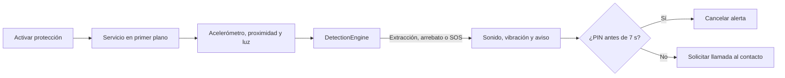

# AlertCusco

Aplicación Android de protección personal. La persona configura un contacto y un PIN, activa la protección y puede generar una alerta por un gesto voluntario o por un movimiento compatible con la extracción o el arrebato del celular. La alerta reproduce el sonido de alarma del teléfono, vibra y, tras siete segundos sin cancelación, solicita una llamada al contacto.

La aplicación reconoce **patrones de sensores**, no puede determinar con certeza que ocurrió un robo. No envía SMS ni almacena las lecturas de sensores en Firebase.

## Recorrido de una alerta



1. [MainActivity.kt](app/src/main/java/com/example/evaluacin_consolidado2/MainActivity.kt) comprueba contacto, PIN, acelerómetro y permiso de llamada.
2. [ProtectionService.kt](app/src/main/java/com/example/evaluacin_consolidado2/ProtectionService.kt) inicia una notificación persistente y registra los sensores. La protección sigue activa si la pantalla de la app deja de estar visible, mientras el servicio continúe en ejecución.
3. Cada evento se envía a [DetectionEngine.kt](app/src/main/java/com/example/evaluacin_consolidado2/DetectionEngine.kt), que devuelve `EXTRACTION`, `SNATCH`, `SOS` o `null`.
4. Ante un disparo, el servicio inicia la alarma y la vibración, publica el estado en la interfaz y abre una ventana de siete segundos para cancelar con PIN.
5. Si no se cancela, `sendAlert()` detiene el sonido y llama mediante `TelecomManager.placeCall()`. La app confirma que solicitó la llamada; Android, la SIM y la red determinan si se establece.

## Qué mide cada sensor

| Sensor | Dato recibido | Uso en AlertCusco |
| --- | --- | --- |
| Acelerómetro | Tres componentes `x`, `y`, `z` en m/s² | Calcula la intensidad del movimiento; reconoce tirones y sacudidas. |
| Proximidad | Distancia respecto del sensor frontal | Distingue entre sensor cubierto y libre para vigilar el bolsillo. |
| Luz ambiental | Iluminación en lux | Ayuda a confirmar que el celular está guardado y que recibió luz al salir. |

El acelerómetro mide **aceleración**, no velocidad ni ubicación. Sus valores incluyen la gravedad. En `onAcceleration()` se mantiene una estimación de gravedad por eje:

```text
gravedad_actual = 0,95 × gravedad_anterior + 0,05 × lectura_actual
movimiento = √[(x − gravedad_x)² + (y − gravedad_y)² + (z − gravedad_z)²]
```

`motion` es ese movimiento aproximado sin gravedad, en m/s². La interfaz lo presenta en la tarjeta «Sensores en tiempo real». Los umbrales son decisiones de esta app; deben comprobarse en el teléfono físico porque los modelos de sensores y la forma de mover el equipo varían.

## Reglas de detección actuales

| Situación | Condición en el código | Resultado |
| --- | --- | --- |
| Armar bolsillo | Proximidad cubierta y luz ≤ 10 lx durante 3 s | Estado «Guardado y protegido». |
| Extracción del bolsillo | Ya armado, proximidad pasa a libre, luz sube a ≥ 18 lx o al menos 12 lx sobre la luz guardada, y movimiento ≥ 12 m/s²; las tres señales deben coincidir en 1,8 s | `EXTRACTION`. |
| Posible arrebato en la mano | Fuera del estado de bolsillo: un pico ≥ 27 m/s², o dos picos ≥ 19 m/s² separados por no más de 850 ms; espera 1,2 s desde la última sacudida para distinguirlo del SOS | `SNATCH`. |
| SOS voluntario | Tres picos de movimiento ≥ 8,5 m/s², separados al menos 300 ms; el detector se rearma cuando el movimiento baja a ≤ 5 m/s². En el código actual, cada nueva sacudida debe llegar dentro de 3 s de la anterior | `SOS`. |

Las tres sacudidas tienen prioridad si se completan antes de que venza la espera del posible arrebato. La detección de bolsillo necesita proximidad y luz; si faltan, siguen disponibles el movimiento en mano y el SOS. Un movimiento fuerte puede producir falsos positivos, por eso existe la cuenta regresiva y la cancelación con PIN.

## Dónde está cada función

### Interfaz y cuentas

| Archivo y función | Responsabilidad |
| --- | --- |
| `MainActivity.onCreate()` | Prepara la ventana y muestra la interfaz Compose. |
| `AccountGate()` | Observa el usuario de Firebase y decide entre acceso, perfil incompleto o pantalla principal. Carga el perfil remoto cuando hay sesión. |
| `AccessScreen()` | Valida registro e ingreso por correo/contraseña; ofrece el ingreso con Google. |
| `CompleteProfileScreen()` | Pide nombre y celular cuando una cuenta autenticada aún no tiene perfil. |
| `AccountLayout()` | Reutiliza el diseño de las pantallas de cuenta. |
| `AlertCuscoScreen()` | Muestra estado, contacto, sensores y alertas; gestiona el PIN y los permisos. |
| `activate()` dentro de `AlertCuscoScreen()` | Exige contacto y PIN, comprueba el acelerómetro y solicita `CALL_PHONE` y, cuando corresponde, permiso de notificaciones. |
| `StatusCard()`, `AlertCard()` | Muestran el estado normal o la alerta con su cuenta regresiva y causa. |
| `SensorsCard()`, `SensorLine()` | Presentan las lecturas y avisan si falta un sensor. |
| `SectionCard()` | Aplica un diseño consistente a cada sección. |
| `AnimatedMark()` | Carga y reproduce las animaciones JSON con Lottie. |

### Detección

| Función de `DetectionEngine.kt` | Responsabilidad |
| --- | --- |
| `onProximity()` | Actualiza si el sensor está cubierto y registra la transición de cubierto a libre. |
| `onLight()` | Guarda los lux y registra un aumento de luz durante la extracción. |
| `onAcceleration()` | Filtra la gravedad, calcula `motion`, cuenta sacudidas y registra tirones fuertes. Puede devolver un disparo inmediato. |
| `tick()` | Actualiza los tiempos aunque no llegue un evento nuevo; puede confirmar un arrebato tras la espera. |
| `updatePocket()` | Arma el bolsillo después de tres segundos con proximidad cubierta y poca luz. |
| `beginExtraction()` | Abre o reinicia la ventana de 1,8 segundos para reunir las tres señales. |
| `evaluateExtraction()` | Comprueba las señales, descarta una ventana vencida y devuelve `EXTRACTION` cuando se cumplen todas. |
| `reset()` | Limpia el estado temporal después de un disparo o una cancelación. |

### Servicio, sonido y llamada

| Función de `ProtectionService.kt` | Responsabilidad |
| --- | --- |
| `command()` | Envía al servicio las acciones `START`, `DISMISS` y `STOP`. |
| `onCreate()` | Obtiene `SensorManager`, `NotificationManager` y los sensores disponibles; crea canales de notificación. |
| `onStartCommand()` | Recibe la acción y arranca, cancela una alerta o detiene el servicio. Usa `START_NOT_STICKY`: Android no reinicia automáticamente una sesión terminada por el sistema. |
| `startProtection()` | Valida sesión, contacto, PIN, permiso de llamada y acelerómetro. Inicia el servicio en primer plano y registra listeners. |
| `onSensorChanged()` | Enruta cada lectura al método correspondiente de `DetectionEngine` y actualiza la pantalla. |
| `pulse.run()` | Se ejecuta aproximadamente cada 250 ms: llama a `tick()`, actualiza la cuenta regresiva y ejecuta `sendAlert()` cuando vence. |
| `triggerAlert()` | Guarda la causa, fija el plazo de siete segundos, llama a `startSiren()` y publica la notificación de alerta. |
| `startSiren()` | Intenta subir el volumen de alarma, reproduce en bucle el tono de alarma configurado en Android y activa vibración repetida. Si ese tono falla, usa `ToneGenerator`. |
| `sirenPulse.run()` | Repite el pitido de respaldo cuando se usa `ToneGenerator`. |
| `sendAlert()` | Valida de nuevo sesión, número y permiso; detiene la alarma y solicita la llamada a `+51` seguido del móvil configurado. No envía SMS. |
| `publish()` y `publishResult()` | Colocan fase, sensores, tiempo restante y resultado en `ProtectionState.snapshot`, que Compose observa. |
| `dismissAlert()` | Detiene la alarma, cancela la notificación y registra qué tipo de alerta se canceló. |
| `stopSiren()` | Libera sonido y vibración y restaura el volumen previo. |
| `onDestroy()` | Quita los listeners de sensores, callbacks y alarma al terminar la protección. |
| `createChannels()`, `protectionNotification()`, `alertNotification()`, `openAppIntent()` | Preparan las notificaciones y el acceso a la app al tocarlas. El canal de alerta no añade otro sonido porque la alarma se reproduce por separado. |
| `onAccuracyChanged()` y `onBind()` | Satisfacen las interfaces de Android; no hay una tarea adicional al cambiar precisión ni se ofrece enlace al servicio. |

### Perfil y almacenamiento

| Archivo y función | Responsabilidad |
| --- | --- |
| `ProtectionConfig.setPin()` | Guarda un hash SHA-256 del PIN de cuatro dígitos con sal aleatoria, sin guardar el PIN en claro. |
| `ProtectionConfig.checkPin()` | Recalcula el hash y compara los valores. |
| `ProtectionConfig.hash()` | Implementa el cálculo del hash con sal. |
| `localNumber()`, `validNumber()`, `dialNumber()` | Aceptan un móvil peruano de nueve dígitos, conservan compatibilidad con números antiguos `+51` y añaden `+51` al llamar. |
| `FirebaseProfiles.create()` | Guarda nombre y celular bajo `users/{uid}`. |
| `FirebaseProfiles.load()` | Recupera el perfil y el contacto si existen. |
| `FirebaseProfiles.saveContact()` | Actualiza nombre y número del contacto de confianza. |
| `GoogleAccess.idToken()` | Obtiene una credencial de Google mediante Credential Manager. |
| `GoogleAccess.signIn()` | Intercambia el token de Google por una sesión de Firebase. |
| `GoogleAccess.clearSelection()` | Limpia el estado del selector de cuentas al cerrar sesión. |

Realtime Database guarda únicamente `name`, `phone`, `contactName` y `contactNumber` bajo `users/{uid}`. El PIN con sal queda en preferencias locales separadas por UID. Las lecturas y alertas no se guardan en la base. [firebase-database.rules.json](firebase-database.rules.json) restringe cada perfil a su usuario autenticado. La regla de teléfono admite un formato más amplio que el formulario; el formulario solo acepta móviles peruanos.

## Ciclo de vida y permisos

Los sensores se registran **solo al activar la protección**. El acelerómetro es obligatorio; proximidad y luz son opcionales. El servicio en primer plano mantiene una notificación visible mientras trabaja. Al desactivar la protección, `onDestroy()` llama a `unregisterListener()`, elimina callbacks y detiene sonido y vibración. Esto evita seguir leyendo sensores sin una sesión activa.

`AndroidManifest.xml` declara `CALL_PHONE`, `VIBRATE`, `MODIFY_AUDIO_SETTINGS`, `POST_NOTIFICATIONS`, Internet y permisos del servicio en primer plano. No declara `SEND_SMS`. El permiso de llamada se solicita en tiempo de ejecución. El servicio lo comprueba otra vez antes de activarse y antes de llamar.

## Preparación y pruebas

1. Abre el proyecto con Android Studio.
2. Coloca tu propio archivo de Firebase en `app/google-services.json`. Está ignorado por Git y no se publica. Debe corresponder al `applicationId` `com.example.evaluacin_consolidado2`; el nombre visible de la app es AlertCusco.
3. Habilita los métodos de acceso que usarás en Firebase Authentication y configura Realtime Database con las reglas del repositorio.
4. Compila con `./gradlew :app:testDebugUnitTest :app:assembleDebug` o, en Windows, `./gradlew.bat :app:testDebugUnitTest :app:assembleDebug`.
5. En un Android físico con SIM, configura como contacto **otro número de prueba**, concede el permiso de llamada y verifica cada gesto. No uses números de emergencias.

`DetectionEngineTest.kt` comprueba armado, extracción, arrebato, sacudidas y movimientos ordinarios. `ProtectionConfigTest.kt` comprueba los números peruanos. La prueba instrumentada `SimulationSensorsTest.kt` inicia el servicio en un modo interno que evita llamadas y confirma que las lecturas empiezan y se detienen; ese modo no aparece en la interfaz. Una prueba en emulador no confirma que una llamada real se conecte ni calibra los umbrales para un teléfono físico.

## Preguntas que conviene saber responder

- **¿Por qué tres sensores?** Proximidad y luz dan contexto de bolsillo; el acelerómetro confirma movimiento. Para el SOS y el arrebato en mano basta el acelerómetro.
- **¿El acelerómetro detecta robos?** No. Mide aceleración; el algoritmo interpreta patrones y puede equivocarse.
- **¿Por qué se resta la gravedad?** Para que la lectura de aproximadamente 9,8 m/s² que produce estar quieto no se confunda con una sacudida.
- **¿Por qué se usa `elapsedRealtime()`?** Las ventanas de 1,8, 3 y 7 segundos deben depender de tiempo transcurrido, no de cambios en la hora del reloj.
- **¿Por qué no se registran los sensores al abrir la app?** Solo son necesarios durante la protección; mantener listeners sin uso consume recursos.
- **¿Qué pasa sin luz o proximidad?** No puede confirmarse el bolsillo, pero permanecen el SOS y el posible arrebato por movimiento.
- **¿Cuándo suena?** En `triggerAlert()`, justo después de que `DetectionEngine` devuelve un disparo. `startSiren()` reproduce la alarma y vibra; `sendAlert()` la detiene antes de solicitar la llamada.
- **¿Por qué la notificación no tiene sonido propio?** Para evitar duplicar la alarma que reproduce `MediaPlayer`.
- **¿La app garantiza que el contacto recibe ayuda?** No. `placeCall()` solicita la llamada al sistema; la conexión depende del teléfono, la SIM y la red. La app tampoco comprueba si contestaron.
- **¿Qué protege el PIN?** Evita una cancelación casual desde la interfaz. Es un PIN corto y local; no debe presentarse como protección criptográfica absoluta.

Referencias de Android: [sensores y ciclo de vida](https://developer.android.com/develop/sensors-and-location/sensors/sensors_overview), [servicios en primer plano](https://developer.android.com/develop/background-work/services/fgs), [llamadas con `TelecomManager`](https://developer.android.com/reference/android/telecom/TelecomManager#placeCall(android.net.Uri,android.os.Bundle)).
